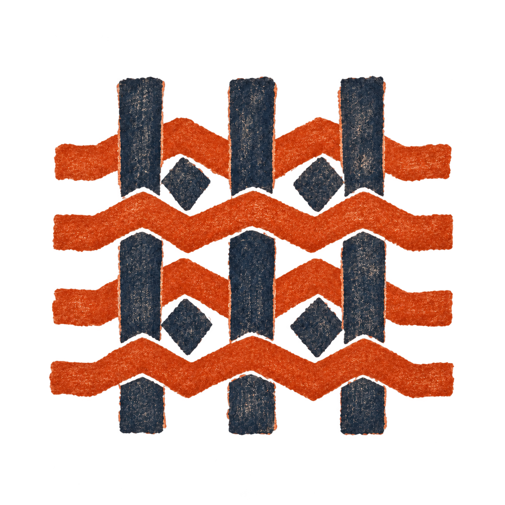

# Mitema



Mitema は、概念どうしの関係を短いテキストで書き表す言語です。物語の登場人物が誰に何をしたか、ある象徴から何を連想するか、二つの題材のどこが対応するかを書き留められます。

Mitema という名前は、神話素（英語で *mytheme*）を意味するスペイン語の *mitema* に由来します。

## 比喩を書いてみる

「国を船にたとえると、船長に当たるのは誰か」。テキストファイルの本文を `[[名前]]` で始め、その下に見立てと対応を書きます。

```text
[[船の比喩]]
国 => 船

航海 map 統治 {
  船長 -> 統治者
  船   -> 国
}

船長 -[舵を取る]-> 船 map 統治者 -[治める]-> 国
```

- `国 => 船` は「国を船として捉える」と読みます。
- `航海 map 統治` の波括弧の中では、`->` で対応を一組ずつ示します。航海での船長は統治者に、船は国に当たります。
- 最後の一行は、関係全体の対応です。船長が船の舵を取ることを、統治者が国を治めることに重ねています。

## 人物ごとの視点を書く

同じ航海でも、誰が語るかによって確かに言えることは変わります。

```text
[[航海日誌]]
view 船医 {
  船長 -[相談する]-> 船医
}
view 見習い {
  船長 -[相談する]-> 船医?
}
```

船医の視点では、船長から相談を受けたことが確かです。見習いの行の末尾にある `?` は、相談があったかどうか判断を保留していることを示します。各視点には、その視点での読みを明示します。

## よく使う記法

| 書き方 | 読み方 |
|---|---|
| `船長 = 船の指揮を執る人` | 「船長」の意味を定義する |
| `船 : [船体, 帆]` | 船体と帆を、それぞれ船の構成要素として挙げる |
| `羅針盤 -> 方角` | 羅針盤から方角を連想する |
| `船長 + 航海士 -[決める]-> 進路` | 船長と航海士が一緒に進路を決める |
| `見習い =[任命]=> 航海士` | 任命を経て、見習いが航海士になる |

## 仕様とライセンス

現在は定義ファイルの仕様を策定しています。初版では関係の記録を扱い、検索や抽出は別のツールに委ねる方針です。

- [定義ファイル仕様](SPEC.md) — 演算子の一覧、セクションの分け方、注釈、文法（EBNF）。
- [MIT ライセンス](LICENSE)
